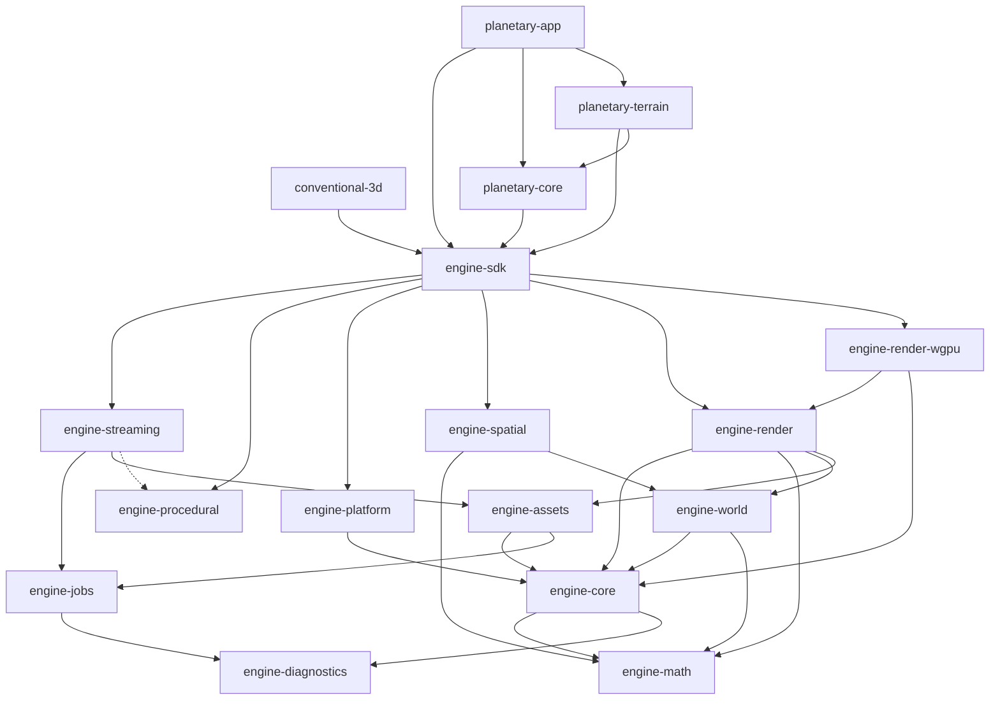

# Dependency Direction

Dependencies flow downward only: a crate may depend only on crates of a strictly lower tier. Extensions depend on the engine through `engine-sdk`, and nothing under `crates/` ever depends on `extensions/` (Core Value, HLD 5.1 / 22.4).

| Crate | Path | Tier | May depend on |
|-------|------|------|---------------|
| `engine-math` | crates/engine-math | 0 | none |
| `engine-diagnostics` | crates/engine-diagnostics | 0 | none |
| `engine-core` | crates/engine-core | 1 | `engine-math`, `engine-diagnostics` |
| `engine-jobs` | crates/engine-jobs | 1 | `engine-diagnostics` |
| `engine-procedural` | crates/engine-procedural | 1 | `engine-math`, `engine-diagnostics` (currently none) |
| `engine-platform` | crates/engine-platform | 2 | `engine-core` |
| `engine-assets` | crates/engine-assets | 2 | `engine-core`, `engine-jobs` |
| `engine-world` | crates/engine-world | 2 | `engine-core`, `engine-math` |
| `engine-spatial` | crates/engine-spatial | 3 | `engine-math`, `engine-world` |
| `engine-render` | crates/engine-render | 3 | `engine-core`, `engine-math`, `engine-world`, `engine-assets` |
| `engine-streaming` | crates/engine-streaming | 3 | `engine-jobs`, `engine-assets`; dev-only: `engine-procedural` |
| `engine-render-wgpu` | crates/engine-render-wgpu | 4 | `engine-render`, `engine-core` |
| `debug-ui` | crates/debug-ui | 4 | `engine-diagnostics`; external `egui` only (no wgpu, winit, egui-winit) |
| `engine-sdk` | crates/engine-sdk | 5 | all engine-* crates above |
| `conventional-3d` | extensions/conventional-3d | 6 | `engine-sdk` |
| `planetary-core` | extensions/planetary/planetary-core | 6 | `engine-sdk` |
| `planetary-terrain` | extensions/planetary/planetary-terrain | 7 | `engine-sdk`, `planetary-core` |
| `planetary-app` | extensions/planetary/planetary-app | 8 | `engine-sdk`, `planetary-core`, `planetary-terrain`; dev-only: `engine-render`, `engine-render-wgpu` (atmosphere image-scene test, ADR-0019) |
| `xtask` | xtask | tooling (exempt from tiers) | none (uses cargo_metadata) |
| `ecs-bench` | spikes/ecs-bench | tooling (exempt from tiers) | `engine-math`, `engine-world`; the only crate allowed to depend on `hecs` (ADR-0017) |

## Checked rules

Enforced by `cargo xtask check-deps`; the IDs below are the exact rule IDs it reports.

- `core-depends-on-extension` (R1): no package under `crates/` may depend (normal, dev or build) on a package under `extensions/`.
- `wgpu-outside-allowed-crate` (R2): only `engine-render-wgpu` may declare a dependency on `wgpu` or on `egui-wgpu` (which links wgpu; ADR-0018). `debug-ui` has no GPU or window dependencies (pure `egui`).
- `winit-outside-allowed-crate` (R3): only `engine-platform` may declare a dependency on `winit`.
- `extension-cross-dependency` (R4): an extension family (`extensions/conventional-3d`, `extensions/planetary/*`) may not depend on another family.
- `tier-violation` (R5): a workspace crate may only depend on workspace crates of a strictly lower tier.
- `unlisted-crate` (R6): every workspace package under `crates/` or `extensions/` must appear in the layer table (`xtask/src/layers.rs`).

## Third-party isolation

`wgpu` is allowed only in `engine-render-wgpu`, and `winit` only in `engine-platform`. `gltf` is allowed only in `conventional-3d`, and `image` only in `conventional-3d` and `gltf` (ADR-0007). This is enforced directly by `cargo xtask check-deps` (declared dependencies) and transitively by cargo-deny `[bans]` `wrappers` (`deny.toml`).

## Canary (PLAN-01)

`cargo xtask check-canary` resolves the full (transitive) dependency graph of `conventional-3d` (normal, dev and build edges) and reports rule `canary-planetary-reachable` if any package named `planetary-*` or located under `extensions/planetary/` is reachable. The negative fixture `xtask/fixtures/canary-leak` (a transitive-only leak via `engine-sdk`) must fail. CI additionally deletes `extensions/planetary` and builds, tests and runs the app headless (ADR-0007).

Planetary crates depend on each other only inside the `extensions/planetary` family via path dependencies declared in their own manifests (never in root `[workspace.dependencies]`), so deleting the directory removes every reference.

`engine-streaming` and `engine-procedural` are general-purpose core crates (Phase 6, ADR-0008); planetary key and generator implementations live in `extensions/planetary` and reach them only through `engine-sdk`.

## How to add a crate

1. Add the member to the root `Cargo.toml`.
2. Add a row to `xtask/src/layers.rs` LAYERS with its tier.
3. Add a row to this document.
4. Run `cargo xtask check-deps` and `cargo test -p xtask`.

## Graph

